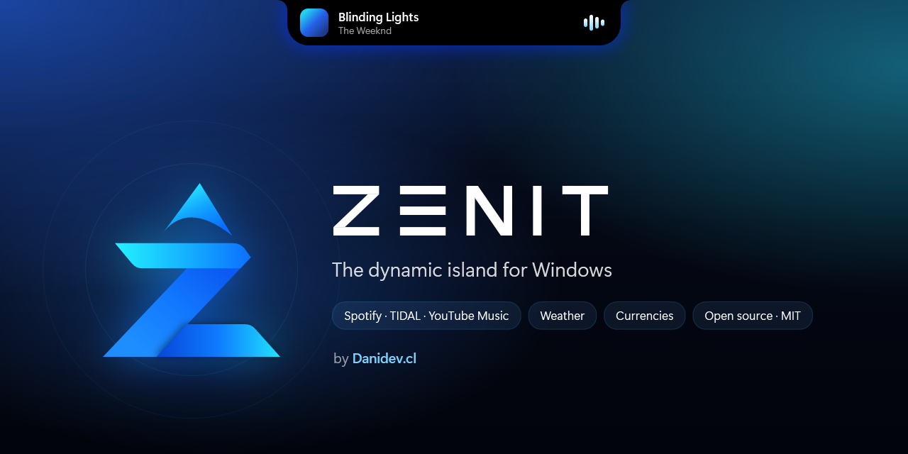

<p align="center">
  
</p>

<p align="center">
  <a href="https://github.com/Dysast3r/zenit/releases/latest"></a>
  <a href="https://github.com/Dysast3r/zenit/releases"></a>
  <a href="LICENSE"></a>
  <a href="https://github.com/Dysast3r/zenit/actions/workflows/build.yml"></a>
  <a href="https://github.com/Dysast3r/zenit/actions/workflows/codeql.yml"></a>
  <a href="https://scorecard.dev/viewer/?uri=github.com/Dysast3r/zenit"></a>
</p>

<p align="center">
  <a href="https://danidev.cl/zenit"><b>danidev.cl/zenit</b></a> · Made by <a href="https://danidev.cl"><b>Danidev.cl</b></a>
</p>

<p align="center">
  <b>English</b> · <a href="README.es.md">Español</a>
</p>

---

**Zenit** is a dynamic island for Windows 10 and 11, inspired by the one on the iPhone. It shows what's playing on Spotify, TIDAL or YouTube Music with album art, progress and controls, plus the weather, exchange rates, world clocks, a Pomodoro and the date, all with smooth, springy animations. Drag it anywhere along the top edge and make it yours with a light or dark theme and an animated neon edge.

It's native (C# / .NET 10), lightweight, open source, and **needs no accounts, API keys or admin rights**.

> **Why "Zenit"?** The zenith is the highest point in the sky, right above you. That's where the island lives: at the very top of your screen.

<p align="center">
  
</p>

## ✨ Features

| | |
|---|---|
| 🎵 **Music** | Spotify, TIDAL and YouTube Music (and optionally any other player): album art, title, a draggable progress bar and controls, with the blurred artwork as a backdrop. The artwork crossfades when the song changes and the equalizer reacts to the actual audio. The island only switches to music mode while something is playing: 5 seconds after you pause, it goes back to normal. |
| 🎤 **Synced lyrics** | The current line, right on time, from [LRCLIB](https://lrclib.net). Close the island on the lyrics page and the compact island keeps showing the current line. |
| ⏱️ **Timer and stopwatch** | A live activity: the countdown stays visible on the compact island. |
| 🍅 **Pomodoro** | 25 minutes of focus, 5-minute breaks and a longer 15-minute one every 4, as a live activity. Stats for today, your streak and the last 7 days, stored only on your PC. |
| 📅 **Meetings** | Get a heads-up before every Google Calendar or Outlook meeting, with a countdown on the island. All it needs is the calendar's private iCal link: no accounts or passwords. |
| 🎚️ **Volume and audio output** | A page with the system volume and every app playing audio (Spotify, Chrome, Discord…), each with its own slider and mute. Switch the output between speakers, headphones, Bluetooth or your monitor without leaving the island. |
| 🔔 **System alerts** | Volume (scroll over the island to change it), battery charging, green and orange camera and microphone dots, and Windows notifications in the Microsoft Store version. |
| 🧩 **Community widgets** | Data from any public API with a plain JSON file, no code. [Make your own](widgets/README.md). |
| 🏝️ **Three styles** | A classic notch attached to the top edge with concave curves, a floating island, or built into the taskbar, where it rises above the bar when it expands. |
| 🎨 **Your style** | Dark or light theme (or follow Windows). A neon edge in the album art color, a color of your choice or a two-color gradient, with pulse, spin or rainbow animations, or turn it off. |
| 👆 **Gestures** | Hover or click to expand · swipe to change songs · swipe the expanded island to switch pages · horizontal touchpad scrolling · hold the right mouse button and drag to move the island along the top edge (it snaps to the center). |
| 🌦️ **Weather** | Your current location or any city in the world, an hourly forecast and animated vector icons. |
| 💱 **Currencies and indicators** | Turn on up to 8 from a list of switches: the dollar, euro, pound, yen, yuan, Latin American currencies, Bitcoin, Ethereum and Chile's UF and UTM, or add any of 300+ currencies and cryptocurrencies. Each one shows its daily change. |
| 🕐 **Clock and date** | 12/24-hour time, seconds, six date formats plus a custom one, week and day of the year. |
| 🌍 **World clocks** | Up to 4 cities with analog faces for day and night. |
| 🙈 **Discreet** | Hidden from screenshots, recordings and screen sharing. It steps aside for full-screen games and videos, and respects Windows Do not disturb. |
| 🖥️ **Multiple displays** | Choose which screen shows the island, or show it on all of them. |
| ⚙️ **Customizable** | A Windows 11-style settings panel: language, theme, size, position, accent color, neon edge, pages, what the idle island shows (time, date, weather, currency or battery) and what the compact island shows in the middle (time, date, temperature or the scrolling song title), and more. |
| 🔄 **Verified updates** | Lets you know when a new version is out and checks its SHA-256 before installing it. |
| 🌐 **English, Spanish and Portuguese** | Follows your Windows language, or pick one yourself. Speak another language? [Help translate](CONTRIBUTING.md). |

## 📥 Installation

1. Download **`Zenit-Setup-<version>-x64.exe`** from [**Releases**](https://github.com/Dysast3r/zenit/releases/latest) (`arm64` if your PC runs on ARM, like a Surface Pro X).
2. Double-click it. It installs in seconds, with no admin rights and no separate .NET install.
3. The island appears at the top of your screen. Double-click the tray icon to open Settings.

Zenit keeps itself up to date and can be uninstalled from **Windows Settings → Apps**. Rather not install anything? Grab the portable `.zip` from the same page and run `Zenit.exe`.

> [!NOTE]
> Until the installer is code-signed, Windows SmartScreen may show "Windows protected your PC". Click **More info → Run anyway**. Before you do, you can check that the file is genuine (see below).

## 🔐 Verify your download

Every release is **built in the open on GitHub Actions** from this code. Each file carries a [build provenance attestation](https://docs.github.com/actions/security-for-github-actions/using-artifact-attestations) signed with Sigstore, which proves it came from this repository and hasn't been tampered with:

```powershell
gh attestation verify .\Zenit-Setup-<version>-x64.exe --repo Dysast3r/zenit
```

You can also compare its hash with the `SHA256SUMS.txt` included in every release:

```powershell
Get-FileHash .\Zenit-Setup-<version>-x64.exe -Algorithm SHA256
```

## 🛡️ Privacy and security

- **No accounts, no API keys, no telemetry.**
- Music info is read locally through the official Windows API (`GlobalSystemMediaTransportControls`), not each service's web API. Only if you turn on the **Lyrics** page are the song title and artist sent to LRCLIB.
- The equalizer only reads the volume **level**; it never records audio.
- Pomodoro stats and settings stay on your PC, in `%AppData%\Zenit`.
- It runs without elevated privileges and installs no services.
- It only connects over HTTPS, and only when you enable the related feature:

  | Data | Service |
  |---|---|
  | Weather and city search | [Open-Meteo](https://open-meteo.com) |
  | Your location's name | [BigDataCloud](https://www.bigdatacloud.com) or [ipapi.co](https://ipapi.co) |
  | Currencies | [currency-api](https://github.com/fawazahmed0/exchange-api) (jsDelivr / Cloudflare) |
  | UF and UTM (Chile) | [findic.cl](https://findic.cl), or [mindicador.cl](https://mindicador.cl) as a fallback |
  | Lyrics | [LRCLIB](https://lrclib.net) |
  | Updates | GitHub Releases |
  | Widgets | Only the URLs of the widgets you install |
  | Meetings | Only the iCal links of the calendars you add |

- Automated analysis with **CodeQL** and **OpenSSF Scorecard**. CI dependencies are kept current by Dependabot, and every action is pinned to a commit.
- Found a security issue? See [SECURITY.md](SECURITY.md).

## 🛠️ Build from source

Requirements: Windows 10 2004 or later and the [.NET 10 SDK](https://dotnet.microsoft.com/download).

```powershell
git clone https://github.com/Dysast3r/zenit
cd zenit
dotnet run --project src/Zenit
```

Debug builds include shortcuts to try the UI without music: `--demo idle|compact|peek|expanded|marquee|meeting|mixer|lyrics|compact-lyrics|clock|timer|live|volume|expanded-volume|weather|currency|world|widgets|tour` and `--settings`.

```
src/Zenit
├── Animation/   Spring physics and velocity tracking for gestures
├── Controls/    Notch shape, neon glow, light/dark theme, equalizer, weather icons, analog clock
├── Interop/     Win32: overlay window, capture exclusion, full-screen detection
├── Services/    Music, weather, location, currencies, audio, timer and Pomodoro, settings and languages
└── Views/       Island, carousel pages, settings and tray
```

No third-party NuGet packages. Want to contribute? Read [CONTRIBUTING.md](CONTRIBUTING.md), look for issues labeled [`good first issue`](https://github.com/Dysast3r/zenit/labels/good%20first%20issue) and check the [roadmap](ROADMAP.md). Translations happen on [Crowdin](crowdin.yml) or through a pull request to `src/Zenit/Assets/i18n`.

## 💙 Support the project

Zenit is free, with no ads or tracking, and it will stay that way. If you like it, you can support it on [**GitHub Sponsors**](https://github.com/sponsors/Dysast3r): it helps cover code signing (so Windows stops showing the SmartScreen warning), a Microsoft Store release and the time behind every new feature. Starring the repository and sharing it helps a lot too.

## 📜 License and notices

[MIT](LICENSE) © 2026 Daniel Moraga · [Danidev.cl](https://danidev.cl). You're free to use, modify and redistribute the code as long as you keep the copyright notice.

Independent project, not affiliated with Apple, Spotify, TIDAL or Google. "Dynamic Island" and "iPhone" are trademarks of Apple Inc.; "Spotify" of Spotify AB; "TIDAL" of TIDAL Music AS; "YouTube Music" of Google LLC.

---

<p align="center">
  Made with 💜 in Chile by <a href="https://danidev.cl"><b>Danidev.cl</b></a>
</p>
