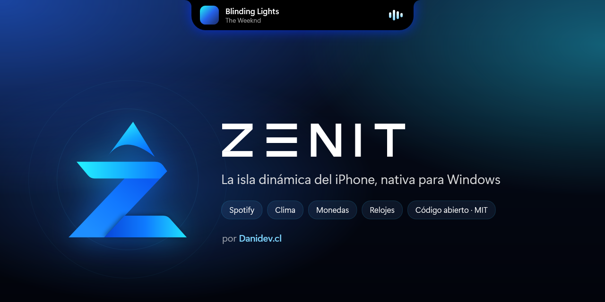

<p align="center">
  
</p>

<p align="center">
  <a href="https://github.com/Dysast3r/zenit/releases/latest"></a>
  <a href="https://github.com/Dysast3r/zenit/releases"></a>
  <a href="LICENSE"></a>
  <a href="https://github.com/Dysast3r/zenit/actions/workflows/build.yml"></a>
  <a href="https://github.com/Dysast3r/zenit/actions/workflows/codeql.yml"></a>
  <a href="https://scorecard.dev/viewer/?uri=github.com/Dysast3r/zenit"></a>
</p>

<p align="center">
  <a href="https://danidev.cl/zenit"><b>danidev.cl/zenit</b></a> · Desarrollado por <a href="https://danidev.cl"><b>Danidev.cl</b></a>
</p>

<p align="center">
  <b>Español</b> · <a href="#english">English</a>
</p>

---

**Zenit** lleva la isla dinámica del iPhone a Windows 10 y 11. Muestra lo que suena en Spotify con carátula, progreso y controles, y además el clima, tipos de cambio, relojes mundiales y la fecha. Todo con animaciones de resorte fluidas como las de iOS.

Es nativa (C# / .NET 10), liviana, de código abierto y **no pide cuentas, claves ni permisos de administrador**.

> **¿Por qué Zenit?** El cénit es el punto más alto del cielo, justo encima de ti. Ahí vive la isla: en lo más alto de tu pantalla.

<p align="center">
  
</p>

## ✨ Funciones

| | |
|---|---|
| 🎵 **Música** | Spotify (y opcionalmente cualquier reproductor): carátula, título, progreso arrastrable y controles, con la carátula desenfocada de fondo. El ecualizador reacciona al audio real. |
| 🎤 **Letras sincronizadas** | La línea que suena en el momento justo, desde [LRCLIB](https://lrclib.net). |
| ⏱️ **Temporizador y cronómetro** | Actividad en vivo: la cuenta regresiva queda visible en la isla compacta, como en iOS. |
| 📅 **Reuniones** | Avisa antes de cada reunión de Google Calendar u Outlook y muestra la cuenta regresiva en la isla. Basta con el enlace iCal privado: sin cuentas ni contraseñas. |
| 🎚️ **Volumen por aplicación** | Una página con el volumen del sistema y de cada app que suena (Spotify, Chrome, Discord…), con su propio deslizador y silencio. |
| 🔔 **Avisos del sistema** | Volumen (y la rueda del mouse sobre la isla para cambiarlo), carga de batería, puntos verde y naranja de cámara y micrófono, y notificaciones de Windows en la versión de la Microsoft Store. |
| 🧩 **Widgets de la comunidad** | Datos de cualquier API pública con un simple archivo JSON, sin código. [Crea el tuyo](widgets/README.md). |
| 🏝️ **Dos estilos** | Notch del iPhone 13 pegado al borde con curvas cóncavas, o isla flotante del iPhone 14 Pro. |
| 👆 **Gestos** | Cursor o clic para expandir · deslizar para cambiar de canción · deslizar la isla expandida para cambiar de página · touchpad horizontal. |
| 🌦️ **Clima** | Ubicación actual o cualquier ciudad del mundo, pronóstico por horas e íconos vectoriales animados. |
| 💱 **Monedas** | Más de 300 monedas y criptomonedas con su variación diaria. |
| 🕐 **Reloj y fecha** | 12/24 h, segundos, seis formatos de fecha más uno personalizado, semana y día del año. |
| 🌍 **Relojes mundiales** | Hasta 4 ciudades con esferas analógicas de día y de noche. |
| 🙈 **Discreta** | No aparece en capturas, grabaciones ni al compartir pantalla. Se oculta en juegos y videos a pantalla completa, y respeta el modo No molestar de Windows. |
| 🖥️ **Varios monitores** | Elige en qué pantalla aparece la isla, o tenla en todas a la vez. |
| ⚙️ **Configurable** | Panel con el estilo de Windows 11: idioma, tamaño, posición, color, páginas, lo que muestra la isla compacta al centro (hora, fecha, temperatura o la canción) y más. |
| 🔄 **Actualizaciones verificadas** | Avisa cuando hay una versión nueva y comprueba su SHA-256 antes de instalarla. |
| 🌐 **Español, inglés y portugués** | Sigue el idioma de Windows o elige uno. ¿Hablas otro idioma? [Ayuda a traducir](CONTRIBUTING.md). |

## 📥 Instalación

1. Descarga **`Zenit-Setup-<versión>-x64.exe`** desde [**Releases**](https://github.com/Dysast3r/zenit/releases/latest) (`arm64` si tu PC es ARM, como un Surface Pro X).
2. Ábrelo con doble clic. Se instala en segundos, sin permisos de administrador ni .NET aparte.
3. La isla aparece arriba de la pantalla. Haz doble clic en el ícono de la bandeja para abrir la configuración.

Zenit se actualiza sola y se desinstala desde **Configuración de Windows → Aplicaciones**. ¿Prefieres no instalar nada? Descarga el `.zip` portable de la misma página y abre `Zenit.exe`.

> [!NOTE]
> Mientras el ejecutable no tenga firma de código, Windows SmartScreen puede mostrar "Windows protegió su PC". Pulsa **Más información → Ejecutar de todas formas**. Antes de hacerlo, puedes verificar que el archivo es auténtico (ver abajo).

## 🔐 Verificar la descarga

Cada versión se compila **públicamente en GitHub Actions** desde este código. Lleva una [atestación de procedencia](https://docs.github.com/actions/security-for-github-actions/using-artifact-attestations) firmada con Sigstore, que prueba que el archivo salió de este repositorio y nadie lo modificó:

```powershell
gh attestation verify .\Zenit-1.0.0-win-x64.zip --repo Dysast3r/zenit
```

También puedes comparar el hash con `SHA256SUMS.txt`, que viene en cada Release:

```powershell
Get-FileHash .\Zenit-1.0.0-win-x64.zip -Algorithm SHA256
```

## 🛡️ Privacidad y seguridad

- **Sin cuentas, claves ni telemetría.**
- La música se lee localmente con la API oficial de Windows (`GlobalSystemMediaTransportControls`), no con la API web de Spotify. Solo si activas la página **Letras** se envían el título y el artista a LRCLIB.
- El ecualizador solo lee el **nivel** de volumen; nunca graba audio.
- Se ejecuta sin privilegios elevados y no instala servicios.
- Solo conecta por HTTPS, y solo si activas la página correspondiente:

  | Dato | Servicio |
  |---|---|
  | Clima y búsqueda de ciudades | [Open-Meteo](https://open-meteo.com) |
  | Nombre de tu ubicación | [BigDataCloud](https://www.bigdatacloud.com) o [ipapi.co](https://ipapi.co) |
  | Monedas | [currency-api](https://github.com/fawazahmed0/exchange-api) (jsDelivr / Cloudflare) |
  | Letras | [LRCLIB](https://lrclib.net) |
  | Actualizaciones | GitHub Releases |
  | Widgets | Solo las URL de los widgets que tú instales |
  | Reuniones | Solo los enlaces iCal de los calendarios que tú agregues |

- Análisis automático con **CodeQL** y **OpenSSF Scorecard**. Las dependencias de CI se actualizan con Dependabot y las acciones están fijadas por commit.
- ¿Encontraste un problema de seguridad? Revisa [SECURITY.md](SECURITY.md).

## 🛠️ Compilar desde el código

Requisitos: Windows 10 2004+ y el [SDK de .NET 10](https://dotnet.microsoft.com/download).

```powershell
git clone https://github.com/Dysast3r/zenit
cd zenit
dotnet run --project src/Zenit
```

En Debug existen atajos para probar la interfaz sin música: `--demo idle|compact|peek|expanded|lyrics|clock|timer|live|volume|weather|currency|world|widgets|tour` y `--settings`.

```
src/Zenit
├── Animation/   Resortes físicos y seguimiento de velocidad para gestos
├── Controls/    Forma del notch, ecualizador, íconos de clima, reloj analógico
├── Interop/     Win32: ventana superpuesta, exclusión de capturas, pantalla completa
├── Services/    Música, clima, ubicación, monedas, audio, ajustes e idiomas
└── Views/       Isla, páginas del carrusel, configuración y bandeja
```

Sin paquetes NuGet de terceros. ¿Quieres aportar? Lee [CONTRIBUTING.md](CONTRIBUTING.md), busca issues con la etiqueta [`good first issue`](https://github.com/Dysast3r/zenit/labels/good%20first%20issue) y revisa el [ROADMAP](ROADMAP.md). Las traducciones se hacen en [Crowdin](crowdin.yml) o con un pull request a `src/Zenit/Assets/i18n`.

## 📜 Licencia y avisos

[MIT](LICENSE) © 2026 Daniel Moraga · [Danidev.cl](https://danidev.cl). Puedes usar, modificar y redistribuir el código libremente, manteniendo el aviso de copyright.

Proyecto independiente, sin relación con Apple ni Spotify. "Dynamic Island" y "iPhone" son marcas de Apple Inc.; "Spotify" es marca de Spotify AB.

---

<a id="english"></a>

## English

**Zenit** brings the iPhone Dynamic Island to Windows 10 and 11. It shows Spotify now-playing with album art, a seekable progress bar and controls, plus weather, 300+ currencies and crypto, world clocks and the date. Everything moves with iOS-style spring physics.

- **Native and light:** C# / .NET 10, no third-party packages, no admin rights, no accounts, no telemetry.
- **Two looks:** an iPhone 13 notch or an iPhone 14 Pro floating island.
- **Live activities:** synced lyrics, timer and stopwatch, a countdown to your next Google Calendar or Outlook meeting (from its private iCal link, no account needed), volume and battery HUDs, camera/mic privacy dots, and community widgets from any public API (plain JSON, no code).
- **Per-app volume:** a page with the system volume and every app playing audio, each with its own slider and mute.
- **Your setup:** pick the display for the island or show it on all of them, choose what the compact island shows in the middle (time, date, temperature or the scrolling song title), and it stays quiet while Windows Do not disturb is on.
- **Private:** hidden from screenshots and screen sharing; music info is read locally through Windows (only title and artist go to LRCLIB if you enable the Lyrics page).
- **Verifiable:** every release is built by GitHub Actions with signed provenance. Check a download with `gh attestation verify <file> --repo Dysast3r/zenit`.
- **UI in English, Spanish and Portuguese:** it follows the Windows language, or you can pick one in Settings. Download the installer (`Zenit-Setup-<version>-x64.exe`) from Releases and double-click it: no admin rights needed.

Download it from [Releases](https://github.com/Dysast3r/zenit/releases/latest). Licensed under [MIT](LICENSE).

---

<p align="center">
  Hecho con 💜 en Chile por <a href="https://danidev.cl"><b>Danidev.cl</b></a> · Made with 💜 in Chile by <a href="https://danidev.cl"><b>Danidev.cl</b></a>
</p>
